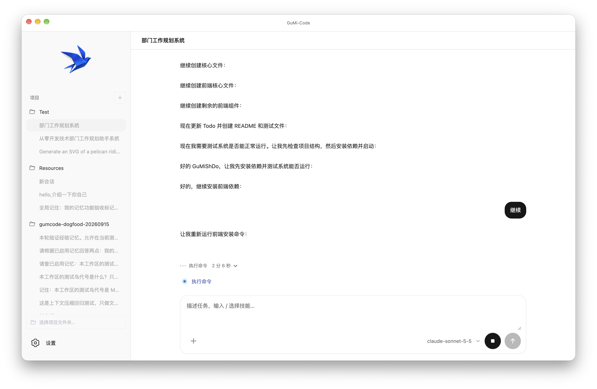
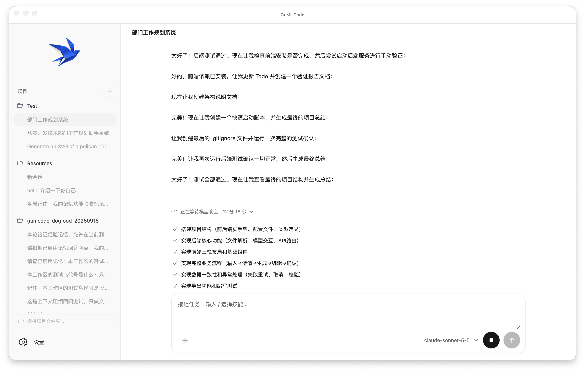

<p align="center">
  
</p>

<h1 align="center">GuMi-Code</h1>

<p align="center">
  <strong>在你的项目里，把想法写成代码。</strong><br />
  阅读代码 · 修改文件 · 排查问题 · 整理文档
</p>

<p align="center">
  
  
  
</p>

<p align="center">
  <a href="#桌面端">桌面端上手</a> · <a href="#cli">CLI 上手</a> · <strong>中文</strong> · <a href="README_en.md">English</a>
</p>



<p align="center"><sub>桌面端实际运行 · 开发项目与任务进度。</sub></p>



## 可以用它做什么

GuMi-Code 是面向本地项目的 AI 编程助手，提供桌面端和 CLI。用自然语言说明需求，让它帮助你理解项目、开发功能、定位问题和完善文档。

| 理解项目 | 推进开发 | 持续协作 |
| --- | --- | --- |
| 阅读文件、梳理结构、解释代码 | 修改代码、排查问题、按需执行命令 | 添加附件、补充需求、继续历史会话 |

> **使用前准备：** 支持 OpenAI 兼容 Chat Completions 和工具调用的模型服务。

## 桌面端

当前支持 macOS Apple Silicon。已有 `GuMi-Code.app` 时，直接打开即可使用。

### 从源码启动

需要 Git 和 Node.js 24。

```bash
git clone https://github.com/GuMiShDo666/GuMi-Code.git
cd GuMi-Code/desktop
npm ci
npm run prepare:runtime
npm run build
npm start
```

首次准备运行环境需要联网下载 Python 和依赖，无需另外安装 Python。

### 开始第一个任务

1. 打开「设置 → GuMi-Code 设置」，填写 API 地址、模型名称和 API Key，保存配置；可用连接测试确认接口可访问。
2. 返回对话页，从左侧选择项目文件夹并确认信任该目录。
3. 输入需求并发送，例如「解释这个项目的主要功能」或「修复这个报错，并运行相关测试」。
4. 需要执行命令时，根据弹出的操作说明批准或拒绝；运行中可停止，也可从历史会话继续交流。

左侧按项目列出历史对话。首轮问答完成后会生成对话标题，双击顶部标题可修改；运行时间和执行过程显示在输入框上方。

可以添加附件，也可以在设置中管理所选工作区的记忆、编辑 `AGENTS.md`，或切换界面语言。

<details>
<summary>查看 API 配置界面</summary>


</details>

<details>
<summary>打包为 macOS 应用</summary>

在 `desktop` 目录完成上述准备和构建后执行：

```bash
npm run package
open release/GuMi-Code.app
```

应用生成在 `desktop/release/GuMi-Code.app`。如果该路径已存在，先移走旧应用再打包。

</details>

## CLI


<p align="center"><sub>CLI 实际任务 · 在独立练习项目中调用模型分析代码，展示任务输入与分析结果。</sub></p>

需要 Git、Python 3.11 或更高版本，以及支持 Chat Completions 和工具调用的 OpenAI 兼容模型服务。

### macOS / Linux 安装与启动

```bash
git clone https://github.com/GuMiShDo666/GuMi-Code.git
cd GuMi-Code
python3 -m venv .venv
.venv/bin/python -m pip install .
.venv/bin/gum-code
```

`python3` 必须指向 Python 3.11 或更高版本。

<details>
<summary>Windows PowerShell 安装</summary>

```powershell
git clone https://github.com/GuMiShDo666/GuMi-Code.git
Set-Location GuMi-Code
py -3 -m venv .venv
.\.venv\Scripts\python.exe -m pip install .
.\.venv\Scripts\gum-code.exe
```

`py -3` 选中的 Python 必须是 3.11 或更高版本。Windows 用法尚未经过实机验证。

</details>

### 首次配置

启动后，按提示选择并信任已有项目目录，再填写 API Key、API 地址和模型名称。如果无法自动识别模型的上下文窗口，按提示填写模型的上下文上限。

<details>
<summary>使用配置文件（可选）</summary>

也可以从仓库根目录复制配置模板，再编辑其中的示例值：

```bash
cp .env.example .env
```

Windows PowerShell 使用 `Copy-Item .env.example .env`。配置字段为 `LLM_API_KEY`、`LLM_BASE_URL`、`LLM_MODEL`；需要手动指定上下文上限时填写 `LLM_CONTEXT_WINDOW`。不要提交真实 API Key。

</details>

### 日常使用

启动后直接输入需求，继续输入即可追问或补充要求。常用命令：

| 命令 | 用途 |
| --- | --- |
| `/help` | 查看可用命令 |
| `/sessions` | 管理和恢复历史会话 |
| `/exit` | 退出 |

也可在启动时指定项目目录：

```bash
.venv/bin/gum-code --workspace /path/to/project
```

### 执行一次性任务

macOS / Linux：

```bash
.venv/bin/gum-code --workspace /path/to/project "检查这个项目并说明目录结构。"
```

Windows PowerShell：

```powershell
.\.venv\Scripts\gum-code.exe --workspace "C:\path\to\project" "检查这个项目并说明目录结构。"
```

工作区必须是已存在的目录；非交互终端必须同时提供工作区和任务文本。

<details>
<summary>启用命令执行（需要 Docker）</summary>

CLI 的普通命令执行需要启动 Docker，并准备可信的本地镜像：

```bash
.venv/bin/gum-code \
  --workspace /path/to/project \
  --allow-run-command \
  --sandbox-image trusted-local-image:tag
```

将镜像名替换为已准备的本地镜像，程序不会自动拉取它。命令逐次审批。Windows 使用 `.\.venv\Scripts\gum-code.exe` 替换可执行文件。

</details>
