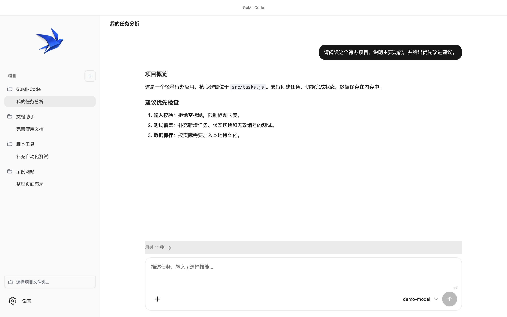
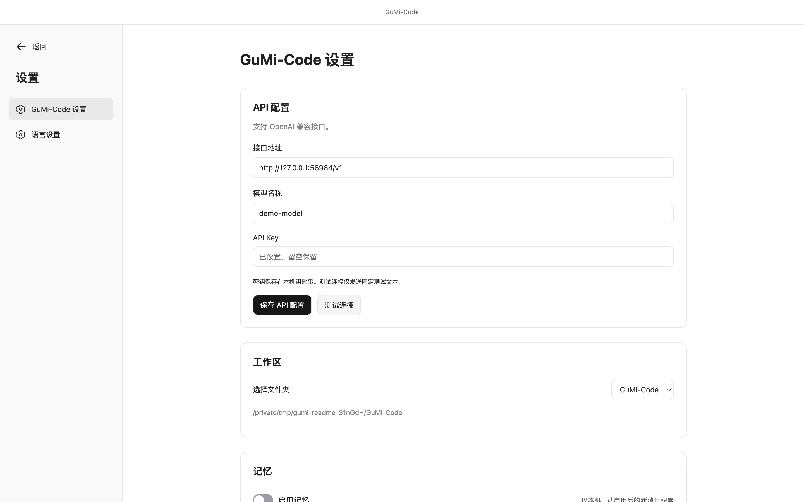
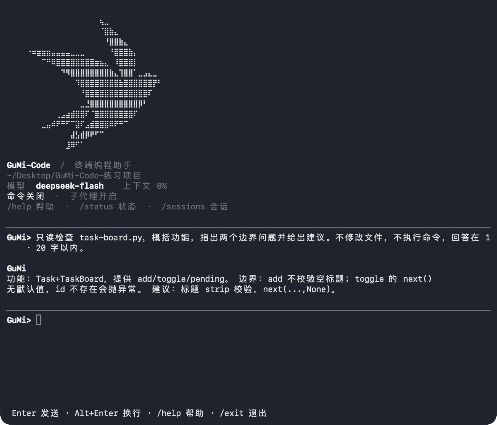

<p align="center">
  
</p>

<h1 align="center">GuMi-Code</h1>

<p align="center">
  <strong>Your local project. Your coding assistant.</strong><br />
  Read code, make changes, and follow up — from the desktop or your terminal.
</p>

<p align="center">
  
  
  
</p>

<p align="center">
  <a href="#desktop">Desktop</a> · <a href="#cli">CLI</a> · <a href="README.md">中文</a> · <strong>English</strong>
</p>



<p align="center"><sub>Desktop in action · Sample project with a local simulated model; file tools run through the actual app.</sub></p>

## What you can do

GuMi-Code is an AI coding assistant for local projects. Describe your task to explore a codebase, edit files, investigate bugs, or write documentation.

| Understand a project | Work on a task | Keep the conversation going |
| --- | --- | --- |
| Read files and explain code | Edit code and request command execution | Add attachments and resume previous sessions |

> **Before you start:** bring an OpenAI-compatible model service that supports Chat Completions and tool calls.

## Desktop

Currently supports macOS on Apple Silicon. If you already have `GuMi-Code.app`, open it to get started.

### Start from source

Requires Git and Node.js 24.

```bash
git clone https://github.com/GuMiShDo666/GuMi-Code.git
cd GuMi-Code/desktop
npm ci
npm run prepare:runtime
npm run build
npm start
```

The first runtime preparation downloads Python and dependencies. You do not need to install Python separately.

### Your first task

1. Open Settings → GuMi-Code settings, enter the API base URL, model name, and API key, then save. Use the connection test to check that the endpoint is reachable.
2. Return to the conversation page, select a project folder from the left sidebar, and confirm that you trust it.
3. Send a request, such as “Explain this project's main features” or “Fix this error and run the relevant tests.”
4. Approve or deny command requests after reviewing the displayed operation. You can stop a running task or continue a previous conversation from history.

The sidebar groups conversations by project. A title is generated after the first question and answer; double-click the header title to rename it. Elapsed time and execution progress appear above the input box.

You can add attachments, manage the selected workspace's memory and `AGENTS.md` in settings, and change the interface language.

<details>
<summary>View API settings</summary>



</details>

<details>
<summary>Package a macOS app</summary>

After preparing and building in the `desktop` directory:

```bash
npm run package
open release/GuMi-Code.app
```

The app is created at `desktop/release/GuMi-Code.app`. Move an existing app out of that path before packaging again.

</details>

## CLI



<p align="center"><sub>CLI in use · A real model analyzes code in an isolated practice project, showing the task and its results.</sub></p>

Requires Git, Python 3.11 or newer, and an OpenAI-compatible model service supporting Chat Completions and tool calls.

### Install and start on macOS / Linux

```bash
git clone https://github.com/GuMiShDo666/GuMi-Code.git
cd GuMi-Code
python3 -m venv .venv
.venv/bin/python -m pip install .
.venv/bin/gum-code
```

Make sure `python3` selects Python 3.11 or newer.

<details>
<summary>Windows PowerShell installation</summary>

```powershell
git clone https://github.com/GuMiShDo666/GuMi-Code.git
Set-Location GuMi-Code
py -3 -m venv .venv
.\.venv\Scripts\python.exe -m pip install .
.\.venv\Scripts\gum-code.exe
```

The interpreter selected by `py -3` must be Python 3.11 or newer. Windows usage has not been verified on a real machine.

</details>

### First-time configuration

Follow the prompts to select and trust an existing project folder, then enter the API key, base URL, and model name. If the model's context window cannot be detected, enter its context limit when prompted.

<details>
<summary>Configure with an environment file</summary>

Alternatively, copy the configuration template from the repository root and edit its example values:

```bash
cp .env.example .env
```

On Windows PowerShell, use `Copy-Item .env.example .env`. The fields are `LLM_API_KEY`, `LLM_BASE_URL`, and `LLM_MODEL`. Set `LLM_CONTEXT_WINDOW` when a manual context limit is needed. Do not commit a real API key.

</details>

### Everyday use

Enter a task after starting the CLI. Keep typing to ask follow-up questions or add requirements.

| Command | Purpose |
| --- | --- |
| `/help` | List available commands |
| `/sessions` | Manage and resume previous sessions |
| `/exit` | Exit |

You can also specify a project directory at startup:

```bash
.venv/bin/gum-code --workspace /path/to/project
```

### Run a one-shot task

macOS / Linux:

```bash
.venv/bin/gum-code --workspace /path/to/project "Inspect this project and explain its directory structure."
```

Windows PowerShell:

```powershell
.\.venv\Scripts\gum-code.exe --workspace "C:\path\to\project" "Inspect this project and explain its directory structure."
```

The workspace must be an existing directory. Non-interactive terminals require both the workspace and task text.

<details>
<summary>Enable command execution with Docker</summary>

Start Docker and prepare a trusted local image before enabling ordinary CLI command execution:

```bash
.venv/bin/gum-code \
  --workspace /path/to/project \
  --allow-run-command \
  --sandbox-image trusted-local-image:tag
```

Replace the image name with an existing local image; the CLI does not pull it automatically. Each command requires approval. On Windows, replace the executable with `.\.venv\Scripts\gum-code.exe`.

</details>
